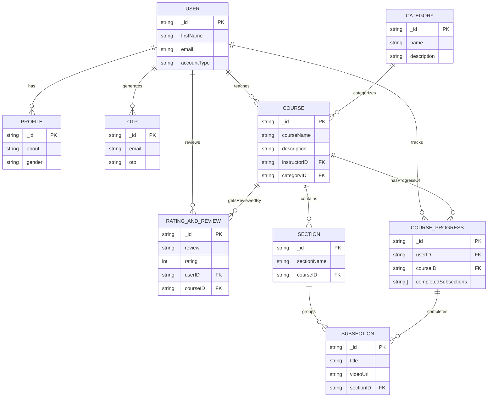

# 🚀 StudyNotion: The All-in-One EdTech Platform

<p align="center"></p>

## Short Description

StudyNotion is a dynamic and comprehensive EdTech platform designed to empower both learners and educators. It offers a robust environment for creating, managing, and consuming online courses, complete with secure payment processing, progress tracking, and interactive review features. Whether you're looking to acquire new skills or share your expertise with the world, StudyNotion provides a seamless and engaging learning experience.

## 🛡️ Project Health & Status

StudyNotion is currently in active development, showcasing a comprehensive feature set for a modern EdTech application. The codebase is structured for scalability and maintainability. While core functionalities are robust, future enhancements will include dedicated unit and integration testing frameworks and CI/CD pipelines to ensure production readiness and continuous delivery with high confidence.

## ✨ Key Features

*   **Secure Authentication & Authorization:** Robust user management with email verification, password reset, and role-based access control (Student, Instructor, Admin).
*   **Course Creation & Management:** Instructors can effortlessly create, organize, and manage courses, including detailed sections and sub-sections.
*   **Rich Media Content:** Seamless integration with Cloudinary for handling video and image uploads, ensuring high-quality course materials.
*   **Progress Tracking:** Students can track their course completion and watch history, fostering a structured learning journey.
*   **Ratings & Reviews:** An integrated system for students to rate and review courses, providing valuable feedback and promoting quality.
*   **Payment Gateway Integration:** Secure course enrollment through Razorpay, offering a smooth and reliable transaction experience.
*   **Profile Management:** Users can update their profiles, including changing profile pictures and personal information.
*   **Interactive UI:** A responsive and intuitive user interface built with React.js and styled using Tailwind CSS.
*   **Email Notifications:** Automated email services for critical actions like course enrollment, password updates, and contact form responses.

## Who is this for?

*   **Aspiring Learners:** Discover a vast catalog of courses across various domains to upskill or learn something new.
*   **Expert Educators:** Share your knowledge and passion by easily creating and publishing your own courses.
*   **EdTech Innovators:** A strong foundation for building and extending powerful online learning experiences.
*   **Developers:** An excellent reference for full-stack MERN applications with modern features and best practices.

## Technology Stack & Architecture

StudyNotion leverages a modern MERN stack for a scalable and performant application:

*   **Frontend:**
    *   **React.js:** A declarative, component-based JavaScript library for building user interfaces.
    *   **Redux Toolkit:** Efficient state management for a predictable application state.
    *   **Tailwind CSS:** A utility-first CSS framework for rapid and consistent styling.
*   **Backend:**
    *   **Node.js & Express.js:** A powerful JavaScript runtime and web framework for building RESTful APIs.
    *   **MongoDB (Mongoose ODM):** A NoSQL database for flexible and scalable data storage.
*   **Cloud Services:**
    *   **Cloudinary:** Cloud-based media management for images and videos.
    *   **Razorpay:** Integrated payment gateway for secure online transactions.
    *   **Nodemailer:** For sending automated email notifications.

## 📊 Architecture & Database Schema

StudyNotion's architecture is built around a clear separation of concerns, ensuring a robust and maintainable system. The backend services communicate with a MongoDB database, whose schema is inferred as follows:



## ⚙️ Configuration & Deployment

To get StudyNotion up and running, you'll need to configure environment variables for both the frontend and backend.

1.  **Environment Variables:** Create a `.env` file in both the project root and the `server/` directory. Populate them with necessary credentials for:
    *   MongoDB Connection URI
    *   Cloudinary API Keys
    *   Razorpay API Keys
    *   JWT Secret for authentication
    *   Email service credentials (e.g., Nodemailer config)
    *   Port numbers
2.  **Install Dependencies:**
    *   Navigate to the root directory and run `npm install`.
    *   Navigate into the `server/` directory and run `npm install`.

## ⚡ Quick Start Guide

Follow these steps to set up and run StudyNotion locally:

1.  **Clone the Repository:**
    ```bash
    git clone https://github.com/grewal16/study_notion.git
    cd study_notion
    ```
2.  **Install Frontend Dependencies:**
    ```bash
    npm install
    ```
3.  **Install Backend Dependencies:**
    ```bash
    cd server
    npm install
    cd .. # Go back to root directory
    ```
4.  **Set up Environment Variables:** Create `.env` files as described in the "Configuration & Deployment" section, both at the project root and in the `server/` directory.
5.  **Start the Backend Server:**
    ```bash
    cd server
    node index.js # or npm start if a start script is defined in server/package.json
    cd ..
    ```
6.  **Start the Frontend Application:**
    ```bash
    npm start
    ```
    This will typically open the application in your browser at `http://localhost:3000`.

## 📜 License

No license file was explicitly found within the repository. Please contact the repository owner for licensing information.